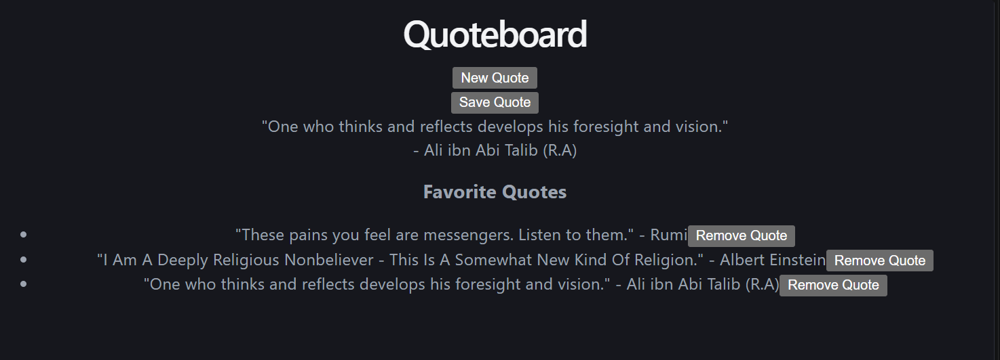

# QuoteBoard

A small React app that fetches a random quote, lets you save your favorites, and remembers them after you refresh the page. Built as my first React project.



## What it does

- Fetches a random quote from the [DummyJSON](https://dummyjson.com/docs/quotes) API when the page loads and when you click **New Quote**
- Shows a loading state while the quote is being fetched
- Shows only an error message (not the old quote) if the request fails
- **Save Quote** adds the current quote to your favorites (duplicates are blocked)
- **Remove Quote** deletes a single favorite
- Favorites are stored in the browser's `localStorage`, so they are still there after a refresh
- Shows "No favorite quotes yet" when the list is empty
- Buttons are disabled while loading to prevent double clicks

## Tech

- React (hooks: `useState`, `useEffect`)
- Vite
- DummyJSON quotes API (`https://dummyjson.com/quotes/random`)
- Browser `localStorage`
- No backend, no login

## Run it locally

```bash
git clone https://github.com/TanviMukka/quoteboard.git
cd quoteboard
npm install
npm run dev
```

Then open the local address Vite prints in the terminal (usually `http://localhost:5173`).

## Project structure

```
quoteboard/
├── public/          # static files (favicon)
├── src/
│   ├── App.jsx      # all app logic and UI
│   ├── App.css      # app styles
│   ├── index.css    # global styles
│   └── main.jsx     # React entry point
├── docs/
│   └── screenshot.png
├── index.html
├── package.json
└── vite.config.js
```

## What I learned

- `useState` holds what the app remembers (quote, loading, error, favorites). `useEffect` runs code on page load and whenever favorites change.
- `fetch` does not throw an error on a 404 or 500 response, so I have to check `response.ok` myself. I used `try / catch / finally` so loading always turns off.
- One ternary chain decides what to show: loading, error, or the quote.
- `.map()` turns an array into list items, and `key` helps React track which item is which. I use the quote text as the key since quotes have no id.
- The spread operator (`[...favQuotes, quote]`) adds items, and `.filter()` removes them.
- `localStorage` only stores text, so I use `JSON.stringify` to save and `JSON.parse` to load. A lazy `useState` initializer reads it once on first render.
- I used Network → Offline to test the error state and Application → Local Storage to inspect saved data.

## Bugs that taught me something

- My first check compared `f.id === favQuotes.id`, but my quotes had no `id`. Both sides were `undefined`, and `undefined === undefined` is `true`, so after the first save every later save was ignored. Fix: compare `f.text === quote.text`.
- The error was being set, but the previous quote was still rendered. Fix: render the error *instead of* the quote.
- My original quotes API was suspended, so I switched to DummyJSON. Free public APIs can disappear, so they are a dependency risk.

## Status

Core app is complete and tested end to end: new quote → save → remove → refresh → favorites still there.

## What's next

- Styling pass (clean CSS, phone-width layout, long quotes)
- Containerize with Docker
- CI with GitHub Actions (build check on every push)
- Auto-deploy so a passing build goes live

## Reflection

What I finished this month:
A basic, working version of **Quoteboard** with a couple of notable features. I'm grateful for the effort I put in and how it has turned out, but I'm excited to make it much better for v2!

What was hardest:
I believe understanding the new concepts, like vite and react, was quite hard. I still don't understand a lot of syntax and the file structures. But, I got a bit of experience with it this month.

What I'd do differently:
Maybe I'd have spent more time focusing on understanding why I was doing something. I mean, I was following Claude's instructions, but I was confused with a few things.

What November adds:
Improve the CSS of the app and also set up Docker and GitHub actions. I'm not sure what Docker or GitHub actions are, and hence I'm excited to learn that.